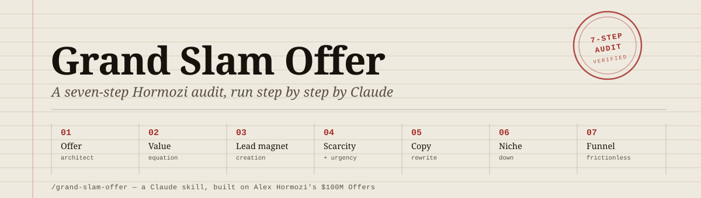
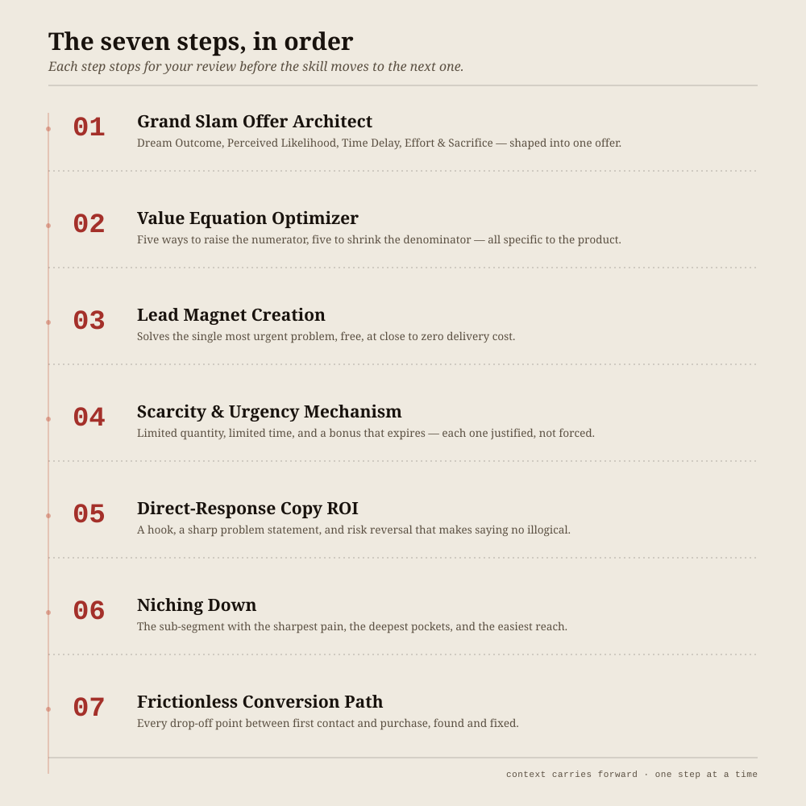

<div align="center">
  
</div>

<br>

<div align="center">

[](https://docs.claude.com/en/docs/claude-code/skills)
[](#install)
[](LICENSE)

</div>

## What this is

**Grand Slam Offer** is a [Claude Skill](https://docs.claude.com/en/docs/claude-code/skills) that runs any product or business through Alex Hormozi's offer-design methodology, from *$100M Offers* and *$100M Leads*. Instead of a one-shot prompt, it conducts a real seven-step audit — gathering context, naming the technique it's applying at each step, and stopping after every step so you can react before it continues.

It isn't tied to one business. Point it at anything — a SaaS product, a local service, a course, an agency — and it adapts.

## The seven steps



## How it works

1. **Context first.** The skill reads what you've already said about your product. If you mention a website or social profile, it researches it before asking you anything — and asks rather than guesses when something's unclear.
2. **States the plan.** Before step one, it gives a short summary of what it understood and what each of the seven steps will cover.
3. **One step at a time.** Each step names the Hormozi technique it's applying, explains the logic in a sentence or two, then does the actual analysis — grounded in specifics about *your* product, not generic marketing advice.
4. **Carries context forward.** The Dream Outcome from step one shapes the lead magnet in step three, the urgency mechanism in step four, the copy in step five, and so on — one coherent strategy, not seven disconnected answers.
5. **Stops after each step.** You read the result, push back, add detail, or say "continue" — your call before it moves on.
6. **Optional wrap-up.** Once all seven are done, it offers (never assumes) to compile everything into a single document.

## Install

Drop the skill folder into your skills directory, or install it directly with Claude Code:

```bash
git clone https://github.com/OnePathToFreedom/grand-slam-offer.git
cp -r grand-slam-offer ~/.claude/skills/grand-slam-offer
```

Then, in any conversation:

```
/grand-slam-offer
```

Tell it about your product, or just a link to it, and the audit starts.

## Example

```
> /grand-slam-offer
> We run a boutique meal-prep delivery service for busy parents in Austin.
> $180/week, 5 dinners, cancel anytime. austinmealprep.com

Claude: Here's what I'm working with — a weekly meal-prep subscription
for Austin parents, $180/5 dinners, no lock-in. I'll take this through
seven steps: offer architecture, the value equation, a lead magnet,
a scarcity mechanism, your sales copy, a niche recommendation, and a
look at where people drop off before buying. Starting with step one.

── Step 1: Grand Slam Offer Architect ──
Applying Hormozi's offer framework — Dream Outcome, Perceived
Likelihood of Success, Time Delay, and Effort & Sacrifice — to see
what's really being sold here and how to sharpen it...
```

## Why this exists

Most "apply the Hormozi framework" prompts return seven generic paragraphs that could belong to any business. This skill is built to go deep on one product at a time: real research, real numbers, real follow-through between steps — the way an actual consultant would work through it with you, not a template filled in on autopilot.

## License

[MIT](LICENSE)
